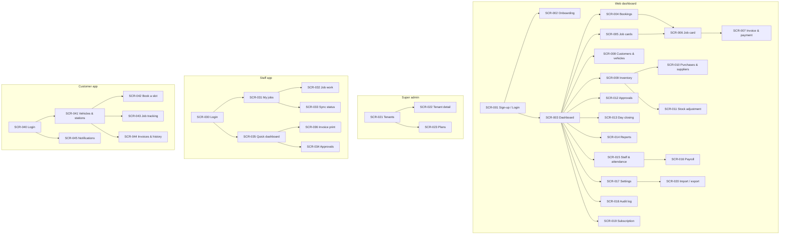
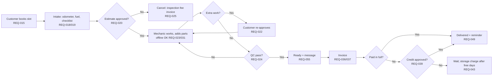
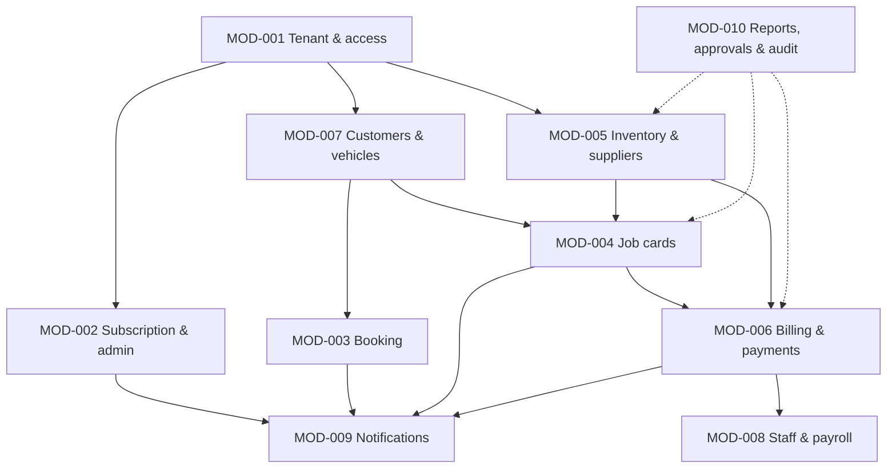

# Visual Product Blueprint — Car Service Station Management SaaS

> State: APPROVED (frozen) | Version: 1.0 (approved from draft v0.1) | Date: 2026-11-13 | Approval: user "ہاں، منظور ہے" (2026-11-13) | Approved inputs: Brief v1.2, PRD v1.1, Architecture v1.0, Implementation Plan v1.0, Tasks v1.0
> This blueprint only presents approved decisions. It adds no features. Nothing has been built: all 75 tasks are NOT_STARTED. Screens are low-fidelity concept sketches, not implemented UI. Styling uses a neutral default colour (provisional design, no brand assets supplied).
> Structured source for the PDF: `blueprint_data.json`.

## Executive summary
- **Problem:** workshops run on paper job cards and spreadsheets. Parts go unbilled, stock and supplier dues are unclear, customers can't see progress, and owners lack daily cash and staff figures.
- **Product:** a multi-tenant SaaS for independent car service stations in Pakistan. It has a web dashboard, an Android Staff app (mechanic work offline up to 24 h) and an Android Customer app. Each station's data is fully isolated.
- **Plans:**
  - Basic PKR 2,500 / month
  - Standard PKR 5,000 / month
  - Premium PKR 8,000 / month
  - Yearly = 10 months' price, with a 14-day full trial
- **Launch scope:** 10 modules and 61 active requirements, with one branch per station, English UI and PKR.
- **Not at launch:** iOS, multi-branch, Urdu UI, FBR e-invoicing, inspection photos, Play Store listing, SMS customer messages.

## Cover and project identity
| Item | Value |
|---|---|
| Project | Car Service Station Management SaaS |
| Blueprint version | 1.0 (APPROVED 2026-11-13) |
| Approved inputs | Brief v1.2 · PRD v1.1 · Architecture v1.0 · Plan v1.0 · Tasks v1.0 |
| Owner | Platform owner's in-house team |
| Country / currency / language | Pakistan · PKR · English |

## Product problem, audience and MVP
See the executive summary above. Plan contents (PRD §4):

| Capability | Basic | Standard | Premium |
|---|---|---|---|
| Job cards, staff app incl. offline, inventory, billing, day closing, customer history, monthly report | ✓ | ✓ | ✓ |
| Manual WhatsApp send (prefilled) | ✓ | ✓ | ✓ |
| Supplier ledger, booking + customer app, approvals inbox, audit log view | — | ✓ | ✓ |
| Automatic WhatsApp from the station's own account (Meta bills the station) | — | ✓ | ✓ |
| Staff attendance, payroll, commission, performance, profit reports | — | — | ✓ |

## Roles / access summary
| Role | Main rights | Key limits |
|---|---|---|
| Super admin | Tenants, plans, payment verification | No station data without an owner's support grant (REQ-005) |
| Owner | Everything in the station | — |
| Manager | Jobs, bookings, QC, attendance, delegated approvals | No profit, payroll or audit log |
| Cashier / advisor | Intake, estimates, invoices, payments | Discount only within the owner's limit |
| Mechanic | Assigned jobs, checklist, parts, stages up to QC | No prices; offline up to 24 h |
| Customer | Book, approve, track, invoices | Only stations they are linked to |

Full matrix: PRD §3.

## Navigation sitemap


## User journey maps and failure/alternative paths

Other journeys (J2 Basic walk-in, J3 stock in, J4 credit release, J5 subscription lapse, J6 payroll) are drawn step by step in the PDF and described in PRD §7.

**Failure paths shown:**
- Estimate rejected → cancellation with inspection fee.
- QC fail → back to work.
- Unpaid and not approved → vehicle held, with an optional storage charge.
- Slot taken → "pick another".
- Station read-only → writes blocked.
- WhatsApp send failed → moved to the manual list.

## Module responsibility map


## Low-fidelity annotated screen wireframes
Twelve representative screens are drawn as concept cards in the PDF:
- **Web:** SCR-003 dashboard, SCR-006 job card, SCR-007 invoice, SCR-009 inventory, SCR-013 day closing, SCR-017 settings, SCR-019 subscription
- **Staff app:** SCR-032 job work, SCR-036 invoice print
- **Customer app:** SCR-042 booking, SCR-043 tracking
- **Super admin:** SCR-022 tenant detail

Each card lists its components, actions and REQ IDs. They are not visual designs; layout and styling are decided during build.

## Architecture, data flows and trust boundaries
```mermaid
flowchart LR
  subgraph Clients[Clients - Flutter]
    SA[Staff app<br/>SQLite + change queue]
    CA[Customer app]
    WD[Web dashboard + super admin]
  end
  subgraph SB[Supabase - Mumbai]
    AUTH[Auth]
    DB[(Postgres + RLS<br/>ledgers + audit)]
    FN[Edge Functions]
    CRON[Scheduler]
    ST[Storage]
  end
  SA <-- sync_pull / sync_apply --> DB
  CA --> DB
  WD --> DB
  SA & CA & WD --> AUTH
  AUTH --> SMS[SMS aggregator<br/>login codes only]
  CRON --> FN --> DB
  FN --> FCM[FCM push]
  FN --> WA[WhatsApp Cloud API<br/>station's own account]
  FN <--> PAY[Payment aggregator]
  SA -. wa.me manual .-> WAPP[WhatsApp on phone]
  WD -. wa.me manual .-> WAPP
```
**Trust boundaries:**
- Apps hold only public keys, and row-level security enforces access.
- Provider and station WhatsApp tokens live only in server secrets.
- Mechanics never receive prices.
- The super admin sees station data only under a support grant.

## AI agents / search / verification where approved
Not applicable — the approved scope contains no AI features.

## Content sources and retention
| Data | Source | Retention |
|---|---|---|
| Station operations | Staff entry | While active; deleted 90 days after closing |
| Customers and vehicles | Staff entry, Excel import, customer app | Same as station |
| Audit log | Database triggers | Life of account; never editable |
| Backups | Supabase daily + weekly off-site copy | 7 days daily; 8 weeks weekly |

## Security, usability and offline behavior
- Isolation tests on every table, run in CI.
- Money rules are enforced in the database.
- Reversal instead of deletion.
- Signed APKs.
- Read-only mode is enforced on the server.
- Offline: the mechanic sees jobs, the checklist, stages and parts for up to 24 h. Conflicts resolve as last change wins, with history kept and the manager alerted. Billing needs a connection.
- Usability targets: screens < 3 s on 4G; 48 dp touch targets; works on Android 8 phones with 2 GB RAM.

## Roadmap and test checkpoints

```mermaid
flowchart LR
  P0[Phase 0<br/>Setup & verify] --> P1[Phase 1<br/>Foundation] --> P2[Phase 2<br/>Inventory, approvals] --> P3[Phase 3<br/>Job cards + offline] --> P4[Phase 4<br/>Billing]
  P4 --> M1((M1 alpha))
  M1 --> P5[Phase 5<br/>Subscription] --> P6[Phase 6<br/>Booking + customer app] --> P7[Phase 7<br/>WhatsApp + push]
  P7 --> M2((M2 beta))
  M2 --> P8[Phase 8<br/>Reports + payroll] --> P9[Phase 9<br/>Hardening + pilot]
  P9 --> M3((M3 launch))
```

| Phase | Tasks | Checkpoint |
|---|---|---|
| 0 | TASK-001…009 | Vendors and spikes verified |
| 1 | TASK-010…019 | Isolation suite green |
| 2 | TASK-020…028 | Average cost and approvals correct |
| 3 | TASK-029…037 | 24 h offline on an Android 8 phone |
| 4 | TASK-038…046 | **M1** Basic journeys pass |
| 5 | TASK-047…052 | Trial → grace → read-only → paid cycle |
| 6 | TASK-053…059 | Concurrency booking test |
| 7 | TASK-060…062 | **M2** WhatsApp automatic + manual |
| 8 | TASK-063…067 | Payroll example = Rs 28,000 |
| 9 | TASK-068…075 | **M3** security, load, E2E, pilot sign-off |

Estimated ~9 months to launch with 2 developers + part-time QA (ASSUMED).

## Risks / unresolved questions / provenance
- **Risks:**
  - correctness of our own offline sync
  - Meta Tech Provider approval delay (manual WhatsApp covers it)
  - stations finding Meta sign-up hard
  - payment aggregator approval time
  - customers hesitant to install APKs
  - schedule and cost are estimates
- **Open:**
  - team size
  - SMS and payment vendors (Phase 0)
  - exact current prices (Phase 0)
- **Provenance:** Brief v1.2, PRD v1.1, Architecture v1.0, Plan v1.0, Tasks v1.0, DECISIONS DEC-001…032 and CR-002.

## A4 export and visual verification record
- Structured source: `blueprint_data.json`
- HTML output: `PROJECT_BLUEPRINT.html`
- PDF output: `PROJECT_BLUEPRINT.pdf`
- PDF engine: local Chrome (WeasyPrint not installed); 14 A4 pages, 657,887 bytes, rendered 2026-11-13
- Pages visually checked (in the built-in browser PDF viewer): cover, roles and journeys, module map, screen cards, architecture and trust boundaries, data, security, roadmap, last page. No clipped text, missing glyphs or broken shapes found.
- Cosmetic notes: some sections start on a new page, leaving white space; the last page holds only the final 2 rows of the source table.
- Fonts and RTL shaping verified? NA — English only
- Approval: APPROVED 2026-11-13 — user "ہاں، منظور ہے" (2026-11-13) — scope: BLUEPRINT.md, blueprint_data.json, PROJECT_BLUEPRINT.html/.pdf v1.0. This is the development handoff; no code exists yet (all tasks NOT_STARTED).
